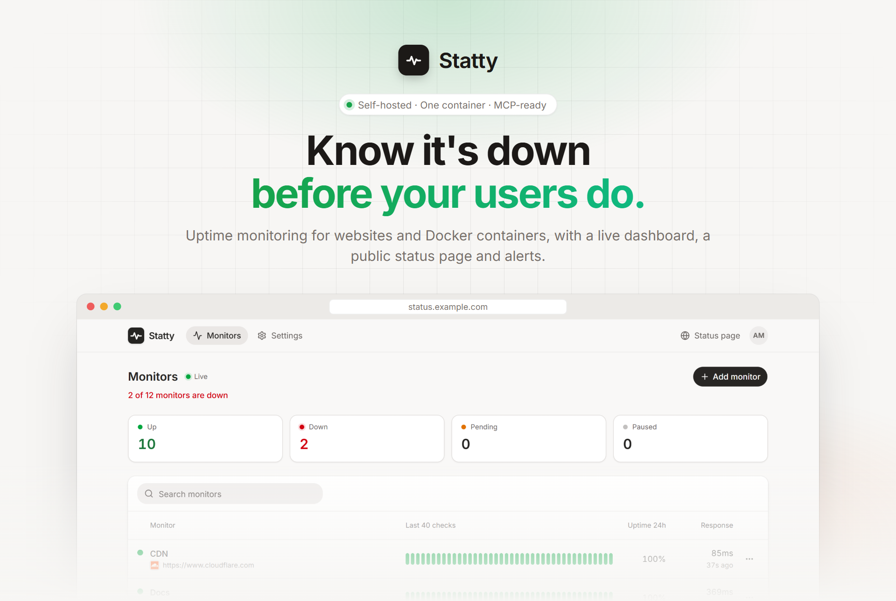
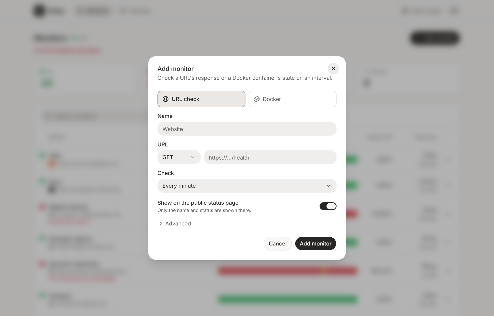
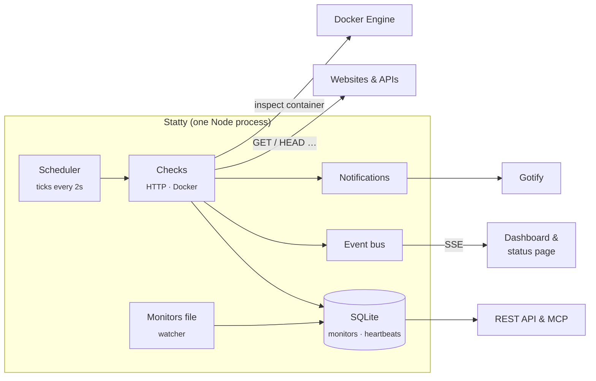

<p align="center">
  <a href="#-quick-start">
    <picture>
      <source media="(prefers-color-scheme: dark)" srcset="docs/screenshots/hero-dark.png">
      
    </picture>
  </a>
</p>

<p align="center">
  <b>The small, self-hosted uptime monitor for your websites and Docker containers.</b><br>
  Live dashboard · public status page · push alerts · REST API · MCP server for AI assistants
</p>

<p align="center">
  <a href="#-quick-start"><b>Quick start</b></a> ·
  <a href="#-features"><b>Features</b></a> ·
  <a href="#-how-it-works"><b>How it works</b></a> ·
  <a href="#-configuration"><b>Configuration</b></a> ·
  <a href="#-rest-api"><b>API</b></a> ·
  <a href="https://github.com/Kellojo/statty/issues/new"><b>Report a bug</b></a>
</p>

<p align="center">
  <a href="https://github.com/Kellojo/statty/actions/workflows/docker-image.yml"></a>
  <a href="https://github.com/Kellojo/statty/releases"></a>
  <a href="https://github.com/Kellojo/statty/pkgs/container/statty"></a>
  
  
</p>

<br>

## 👋 What is Statty?

Statty watches the things you run and tells you the moment one stops working. It's in the
spirit of Uptime Kuma, but deliberately smaller: a flat list of monitors, each one either a
**URL check** (status code, plus an optional keyword in the body) or a **Docker check** (is the
container running, and healthy?).

Around that you get everything you need to run it for real: a live dashboard, a public status
page, push notifications, monitors declared as code, a REST API, and an MCP server so Claude and
other assistants can check on your services. **It's one container and one SQLite file.** No
Redis, no Postgres, no external services.

<table>
  <tr>
    <td align="center" width="25%"><h3>⚡</h3><b>Live</b><br><sub>Results stream in over SSE. No refreshing, no polling.</sub></td>
    <td align="center" width="25%"><h3>🪶</h3><b>Tiny</b><br><sub>One Node process and one SQLite file. Back up by copying a folder.</sub></td>
    <td align="center" width="25%"><h3>📄</h3><b>Config as code</b><br><sub>Declare monitors in YAML. Statty applies changes on its own.</sub></td>
    <td align="center" width="25%"><h3>🤖</h3><b>AI-ready</b><br><sub>Built-in MCP server with OAuth sign-in. Ask Claude what's down.</sub></td>
  </tr>
</table>

## 🚀 Quick start

Up and running in under a minute with the prebuilt image (amd64 and arm64):

```sh
docker run -d --name statty -p 3000:3000 \
  -v statty-data:/data \
  -v /var/run/docker.sock:/var/run/docker.sock:ro \
  -e ORIGIN=http://localhost:3000 \
  ghcr.io/kellojo/statty:latest
```

Open **http://localhost:3000**, create an account (the first one becomes admin) and add your
first monitor. That's it.

<details>
<summary><b>Docker Compose</b></summary>

<br>

```yaml
services:
  statty:
    image: ghcr.io/kellojo/statty:latest
    ports:
      - '3000:3000'
    environment:
      ORIGIN: https://status.example.com
      APP_SECRET: change-me-to-a-long-random-string
    volumes:
      - statty-data:/data
      # Only needed for Docker monitors. Read-only is enough: Statty only inspects containers.
      - /var/run/docker.sock:/var/run/docker.sock:ro
    restart: unless-stopped

volumes:
  statty-data:
```

</details>

<details>
<summary><b>From source</b></summary>

<br>

Needs Node 22 or newer and pnpm.

```sh
pnpm install
cp .env.example .env   # set ORIGIN, APP_SECRET, OIDC_* as needed
pnpm dev               # development server with hot reload
# or
pnpm build && node build
```

The repository's `docker-compose.yml` builds the image from source instead of pulling it.

</details>

> [!TIP]
> Not monitoring containers? Leave out the Docker socket and run the container as `--user node`
> with a `/data` volume that user owns.

## ✨ Features

<table>
  <tr>
    <td width="50%" valign="top">
      <h3>📊 Live dashboard</h3>
      Every monitor at a glance: status, its last 40 checks, 24h uptime and response time.
      Numbers roll, heartbeat bars grow in and rows flash when a status changes, all in real
      time.
      <br><br>
      <picture>
        <source media="(prefers-color-scheme: dark)" srcset="docs/screenshots/dashboard-dark.png">
        
      </picture>
    </td>
    <td width="50%" valign="top">
      <h3>📈 Deep monitor insights</h3>
      How long it's been up or down, the last 60 checks, uptime over 24 hours, 7 days and 30
      days, a response-time chart that marks failures, and a history of status changes.
      <br><br>
      <picture>
        <source media="(prefers-color-scheme: dark)" srcset="docs/screenshots/monitor-dark.png">
        
      </picture>
    </td>
  </tr>
  <tr>
    <td width="50%" valign="top">
      <h3>🌐 Beautiful status page</h3>
      A public page at <code>/status</code> with 90 days of daily uptime per service. It shows
      names and status only, never URLs, containers or error messages, and it updates live.
      <br><br>
      <picture>
        <source media="(prefers-color-scheme: dark)" srcset="docs/screenshots/status-dark.png">
        
      </picture>
    </td>
    <td width="50%" valign="top">
      <h3>🧩 URL and Docker checks</h3>
      Check a URL's status code and body, or a container's state and health. Set the interval,
      timeout and retries per monitor, so one blip doesn't wake you up.
      <br><br>
      <picture>
        <source media="(prefers-color-scheme: dark)" srcset="docs/screenshots/add-monitor-dark.png">
        
      </picture>
    </td>
  </tr>
  <tr>
    <td width="50%" valign="top">
      <h3>🔔 Instant alerts</h3>
      Push to <a href="https://gotify.net">Gotify</a> when a monitor goes down and when it
      recovers, with how long it was down. Route channels to all monitors or a chosen few.
      <br><br>
      <picture>
        <source media="(prefers-color-scheme: dark)" srcset="docs/screenshots/notifications-dark.png">
        
      </picture>
    </td>
    <td width="50%" valign="top">
      <h3>🔑 API and MCP built in</h3>
      Scoped API keys for scripts and CI, and an MCP server that AI clients sign in to with
      OAuth. One command connects Claude Code.
      <br><br>
      <picture>
        <source media="(prefers-color-scheme: dark)" srcset="docs/screenshots/api-dark.png">
        
      </picture>
    </td>
  </tr>
</table>

**And more:**

- 📄 **Monitors as code.** Declare monitors in a [YAML file](#-monitors-file) that Statty applies
  on startup and whenever it changes.
- 🔐 **Sign-in your way.** Email + password, OIDC single sign-on (Pocket ID, Authentik,
  Keycloak, …), or both. The first account becomes admin.
- 🎨 **Site icons.** HTTP monitors pick up their site's favicon automatically.
- 🧹 **Self-maintaining.** Old checks are pruned on a schedule, and migrations run on startup.
- 🔒 **Secure by default.** Secrets encrypted at rest, API keys hashed with argon2, and a status
  page that never leaks internals.

## 🧠 How it works



### Checks

A **scheduler** in the server process ticks every 2 seconds. Each tick it picks the enabled
monitors whose interval has passed and checks them, up to 25 at once, with at most one check
per monitor in flight.

- **URL checks** request the URL with the monitor's method, following redirects. The monitor is
  up when the status code is in the accepted list (e.g. `200-299,301`) and, if set, the body
  contains the keyword. Anything else (an unexpected status, a missing keyword, a timeout, a
  DNS or TLS error) is a failure, and its message says why.
- **Docker checks** call the Docker Engine API (`GET /containers/<name>/json`). A running
  container is up, or up only while healthy if it has a health check. A container whose health
  check is still `starting` is pending. Exited, restarting, paused and unhealthy containers are
  down. Statty only reads, so a read-only socket mount is enough. `DOCKER_HOST` can also point
  at a remote engine over TCP, and each monitor can name its own host.

### Statuses and uptime

Every check is stored as a **heartbeat** (status, response time, message, time), and the
monitor's current state is updated in the same transaction.

| Status         | Meaning                                                               |
| -------------- | --------------------------------------------------------------------- |
| 🟢 **Up**      | The last check passed                                                 |
| 🟠 **Pending** | Failing, but with retries left; or a container that is still starting |
| 🔴 **Down**    | Failed `retries + 1` times in a row (3 by default)                    |
| ⚪ **Paused**  | Disabled; it isn't checked and doesn't notify                         |
| ⚫ **Unknown** | Not checked yet                                                       |

**Uptime** is up checks divided by up and down checks over the period. Pending checks count for
neither, so a blip that recovers within its retries doesn't hurt your numbers. On the status
page, a day is green at 99% uptime or more, amber from 95%, and red below that. Heartbeats older
than `HEARTBEAT_RETENTION_DAYS` (default 90) are pruned every hour.

### Live updates

After each check the server publishes an event. Signed-in pages listen on `/api/events` and the
status page on `/api/public/events`, both as server-sent events, so nothing polls. The public
stream carries the same redacted data as the status page. If the stream can't connect (for
example behind a proxy that buffers responses), pages fall back to reloading every 15–30
seconds.

### Notifications

- **When Statty sends:** when a monitor turns down (from up, pending or not yet checked), and
  when it recovers from down. The recovery message says how long it was down. Pending checks, a
  monitor's first up check and paused monitors never send anything.
- **What it sends:** a markdown message that links to the monitor's page (using `ORIGIN`), at
  the channel's priority (0–10, default 8).
- **Delivery:** in the background, with a 10s timeout, so a slow notification server never
  delays checks. Failures are logged. **Send test** checks a channel from the UI.
- **Token storage:** the token is encrypted at rest (AES-256-GCM, with a key derived from
  `APP_SECRET`) and is never sent back to the browser.

Channels are drivers behind a small interface, so other types (ntfy, webhooks) can be added
later.

### Site icons

For HTTP monitors Statty looks for the site's icon in the background: the home page's `icon` /
`apple-touch-icon` links (preferring SVG or a square PNG of 32px or more), else `/favicon.ico`.
It must be a real image under 256 KB. Icons are cached per origin, refreshed weekly, and a
failed search is retried after a day.

### Storage and security

- **One SQLite file** at `DATABASE_PATH` holds everything: users, monitors, heartbeats,
  settings, keys and cached icons. Back it up by copying the `/data` volume. Numbered SQL
  migrations in `migrations/` are applied on startup.
- **`APP_SECRET`** signs sessions and encrypts stored secrets. If you don't set it, Statty
  generates one into `<database dir>/.secret` (mode 0600). Set it explicitly in production.
- **API keys** look like `sty_<id>_<secret>`. Only an argon2 hash is stored; the key itself is
  shown once.
- The container has a built-in health check against `/api/health`.

## 📄 Monitors file

Instead of clicking monitors together, you can declare them in a YAML file and point
`MONITORS_FILE` at it. Statty applies it on startup and again whenever the file changes (it
re-reads it every `MONITORS_FILE_POLL_SECONDS`). No sync job or API key is needed. The format is
the same as [statty-sync-action](https://github.com/Kellojo/statty-sync-action), so one file
works with both.

```yaml
# statty.yaml
prune: true # delete monitors that are removed from this file (default)
statusPage: # optional
  title: Acme Status
  description: Live status of our services.
monitors:
  - name: Website
    type: http
    url: https://example.com
    intervalSeconds: 60
    retries: 2
  - name: postgres
    type: docker
    container: postgres
    public: false # not on the public status page
  - name: API
    type: http
    url: https://api.example.com/health
    keyword: '"status":"ok"'
    description: ${API_REGION} region # from the environment
```

Each entry takes the [monitor fields](#monitor-fields): `name` and `type` are required, plus
`url` for `http` monitors or `container` for `docker` monitors. See
[`statty.example.yaml`](statty.example.yaml) for a starting point.

- **Matching:** monitors are matched by name, ignoring case, so names must be unique.
- **Only the fields you set are managed.** A field you leave out gets Statty's default on
  create, and is never changed afterwards. If someone edits a field the file sets in the UI, it
  is set back the next time the file is applied.
- **Adopting:** a monitor made in the UI with the same name as an entry is taken over by the
  file.
- **Deleting:** with `prune: true`, a monitor that the file declared is deleted once you remove
  it from the file, along with its history. Monitors made in the UI or API are never deleted.
  With `prune: false`, removed monitors just go back to being managed in the UI.
- **Renaming** an entry creates a new monitor; with `prune` the old one is deleted.
- **Errors:** a file with any error (unknown fields, a missing `url`, invalid YAML) is not
  applied at all, so a typo can't delete monitors. Problems are logged.
- **Environment variables:** `${NAME}` is replaced with the environment variable `NAME`, and
  the file is refused when it isn't set. `$${NAME}` stays a literal `${NAME}`.
- Monitors from the file are labelled "From config file" in the app.

> [!IMPORTANT]
> With Docker, mount the file's **directory**, not the file itself. A single-file bind mount
> keeps showing the old file after an editor or deploy script replaces it.

```yaml
services:
  statty:
    image: ghcr.io/kellojo/statty:latest
    environment:
      MONITORS_FILE: /config/statty.yaml
    volumes:
      - ./data:/data
      - ./config:/config:ro # contains statty.yaml
      - /var/run/docker.sock:/var/run/docker.sock:ro
```

## 🔧 Configuration

All settings are environment variables. See [`.env.example`](.env.example).

| Variable                                              | Default                                                                   | Notes                                                                               |
| ----------------------------------------------------- | ------------------------------------------------------------------------- | ----------------------------------------------------------------------------------- |
| `ORIGIN`                                              | request origin                                                            | Public URL; OAuth and notification links use it (else `localhost:$PORT`)            |
| `APP_SECRET`                                          | generated into `<db dir>/.secret`                                         | Signs sessions and encrypts stored secrets (e.g. Gotify tokens)                     |
| `PORT`                                                | `3000`                                                                    |                                                                                     |
| `DATABASE_PATH`                                       | `./data/statty.db` (`/data/statty.db` in Docker)                          |                                                                                     |
| `ENABLE_SIGNUP` / `ENABLE_PASSWORD_LOGIN`             | `true`                                                                    |                                                                                     |
| `OIDC_ISSUER`, `OIDC_CLIENT_ID`, `OIDC_CLIENT_SECRET` | –                                                                         | Callback URL: `<ORIGIN>/api/auth/oauth2/callback/oidc`                              |
| `OIDC_SCOPES`                                         | `openid profile email`                                                    |                                                                                     |
| `OIDC_ONLY`                                           | `false`                                                                   | Turns off password login and sign-up                                                |
| `AUTO_PROMOTE_FIRST_USER`                             | `true`                                                                    | The first account becomes admin                                                     |
| `DOCKER_HOST`                                         | `unix:///var/run/docker.sock` (Windows: `npipe:////./pipe/docker_engine`) | Also `tcp://host:2375`, `https://host:2376`. A monitor can set its own host.        |
| `HEARTBEAT_RETENTION_DAYS`                            | `90`                                                                      | Older checks are pruned hourly                                                      |
| `MONITORS_FILE`                                       | –                                                                         | YAML file declaring monitors, applied on startup ([Monitors file](#-monitors-file)) |
| `MONITORS_FILE_POLL_SECONDS`                          | `30`                                                                      | How often to re-read `MONITORS_FILE` for changes; `0` reads it on startup only      |

**Sign-in.** To use only single sign-on, set the three `OIDC_*` variables and `OIDC_ONLY=true`.
To stop new sign-ups after you've created your account, set `ENABLE_SIGNUP=false`. Admins
manage users under Settings → Users.

**Reverse proxy.** Set `ORIGIN` to the public URL. If your proxy buffers responses, turn that
off for `/api/events` and `/api/public/events` so live updates stream through (with Nginx:
`proxy_buffering off;`). Statty still works without it, falling back to periodic reloads.

## 🔌 REST API

The API lives at `/api/v1`. Create a key under Settings → API & MCP and send it as a bearer
token:

```sh
curl -H "Authorization: Bearer sty_…" https://status.example.com/api/v1/status
```

Keys have one of two scopes: `status:read` reads monitors and status, and `monitors:write` also
creates, changes, pauses, deletes and checks them.

| Method | Path                                             | Scope            |
| ------ | ------------------------------------------------ | ---------------- |
| GET    | `/api/v1/status`                                 | `status:read`    |
| GET    | `/api/v1/monitors?recent=30`                     | `status:read`    |
| GET    | `/api/v1/monitors/:idOrName`                     | `status:read`    |
| GET    | `/api/v1/monitors/:idOrName/heartbeats?hours=24` | `status:read`    |
| POST   | `/api/v1/monitors`                               | `monitors:write` |
| PATCH  | `/api/v1/monitors/:idOrName`                     | `monitors:write` |
| DELETE | `/api/v1/monitors/:idOrName`                     | `monitors:write` |
| POST   | `/api/v1/monitors/:idOrName/check`               | `monitors:write` |
| GET    | `/api/public/status`                             | none (CORS open) |
| GET    | `/api/monitors/:id/favicon`                      | see below        |

```sh
curl -X POST https://status.example.com/api/v1/monitors \
  -H "Authorization: Bearer sty_…" -H "Content-Type: application/json" \
  -d '{ "name": "Website", "type": "http", "url": "https://example.com", "intervalSeconds": 60 }'
```

Errors come back as `{ "message": "field: problem" }`.

### Monitor fields

| Field              | Type               | Notes                                                                 |
| ------------------ | ------------------ | --------------------------------------------------------------------- |
| `name`             | string             | Required. Unique, ignoring case                                       |
| `type`             | `http` \| `docker` | Required                                                              |
| `url`              | string             | Required for `http`                                                   |
| `method`           | string             | `GET` (default), `HEAD`, `POST`, `PUT`, `PATCH`, `DELETE`, `OPTIONS`  |
| `acceptedStatuses` | string             | Default `200-299`, e.g. `200-299,301`                                 |
| `keyword`          | string             | Text the response body must contain                                   |
| `ignoreTls`        | boolean            | Accept invalid or self-signed certificates                            |
| `container`        | string             | Required for `docker`                                                 |
| `dockerHost`       | string             | Overrides `DOCKER_HOST` for this monitor                              |
| `intervalSeconds`  | number             | 10–86400, default 60                                                  |
| `timeoutSeconds`   | number             | At most the interval, default 10                                      |
| `retries`          | number             | Failures to tolerate before down, default 2 (down on the 3rd failure) |
| `enabled`          | boolean            | `false` pauses the monitor                                            |
| `public`           | boolean            | Show on the status page, default `true`                               |
| `description`      | string             |                                                                       |
| `sortOrder`        | number             |                                                                       |

The schema is in `src/lib/server/monitor/input.ts`. Responses also carry `faviconUrl`, which is
null for Docker monitors or when no icon was found. It points at
`/api/monitors/:id/favicon?v=<hash>`, which serves the cached icon. Public monitors' icons are
served without sign-in; other monitors need a session or `status:read`.

<details>
<summary><b>Notification channel routes</b></summary>

<br>

Notification channels are managed by signed-in admins, not with API keys. The routes are
`GET`/`POST /api/notifications`, `GET`/`PATCH`/`DELETE /api/notifications/:id` and
`POST /api/notifications/:id/test`. A channel body is
`{ name, type: "gotify", enabled, allMonitors, monitorIds, config: { url, token, priority } }`.
On `PATCH`, a blank `config.token` keeps the stored one.

</details>

## 🤖 MCP server

Statty is an [MCP](https://modelcontextprotocol.io) server at `/api/mcp` (Streamable HTTP,
stateless), so AI assistants can answer "is anything down?" or set up monitors for you.

```sh
claude mcp add --transport http statty https://status.example.com/api/mcp
```

- **Sign-in:** MCP clients use OAuth 2.1 with dynamic client registration and PKCE. The first
  time a client connects, your browser opens Statty's sign-in (password or OIDC), and you choose
  whether the client may change monitors. Each approval appears under Settings → API & MCP as a
  key you can revoke.
- **Tools:** `list_monitors` and `get_monitor`. With write access the client also gets
  `create_monitor`, `update_monitor`, `delete_monitor` and `check_monitor`.

## 📦 Releases

| Tag                         | Published when                                                       |
| --------------------------- | -------------------------------------------------------------------- |
| `:latest`, `:0.1.0`, `:0.1` | a version tag is pushed (`git tag v0.1.0 && git push origin v0.1.0`) |
| `:edge`                     | every push to `main`                                                 |
| `:sha-<commit>`             | every build                                                          |

The workflow is `.github/workflows/docker-image.yml`. On a tag it also sets `package.json`'s
version, so the version shown in the app matches the image.

## 💻 Development

<p>
  
  
  
  
  
  
</p>

```sh
pnpm dev     # dev server
pnpm check   # typecheck
pnpm lint    # Prettier and ESLint
pnpm test    # unit tests
```

- Migrations are numbered SQL files in `migrations/` and are applied at startup. To change the
  schema, add the next file; don't edit an applied one.
- Server code lives in `src/lib/server/`:
  - `monitor/`: checks, scheduler and the service layer
  - `monitor-file/`: the monitors file (parsing, applying, watching)
  - `favicon/`: finding, validating and caching site icons
  - `notifications/`: notification channels. Each type is a driver; Gotify is in `gotify.ts`
  - `mcp/`: the MCP server
  - `oauth-server/`: OAuth for MCP
  - `db/repo/`: storage
- Screenshots in `docs/screenshots/` come from a local instance with demo data, in light and
  dark mode. GitHub shows the one that matches the reader's theme.

## 🤝 Contributing

Bug reports, ideas and pull requests are welcome. [Open an issue](https://github.com/Kellojo/statty/issues/new)
to report a bug or suggest a feature, and run `pnpm check`, `pnpm lint` and `pnpm test` before
sending a PR.

<p align="center">
  <sub>If Statty keeps your services honest, consider giving it a ⭐</sub>
</p>
