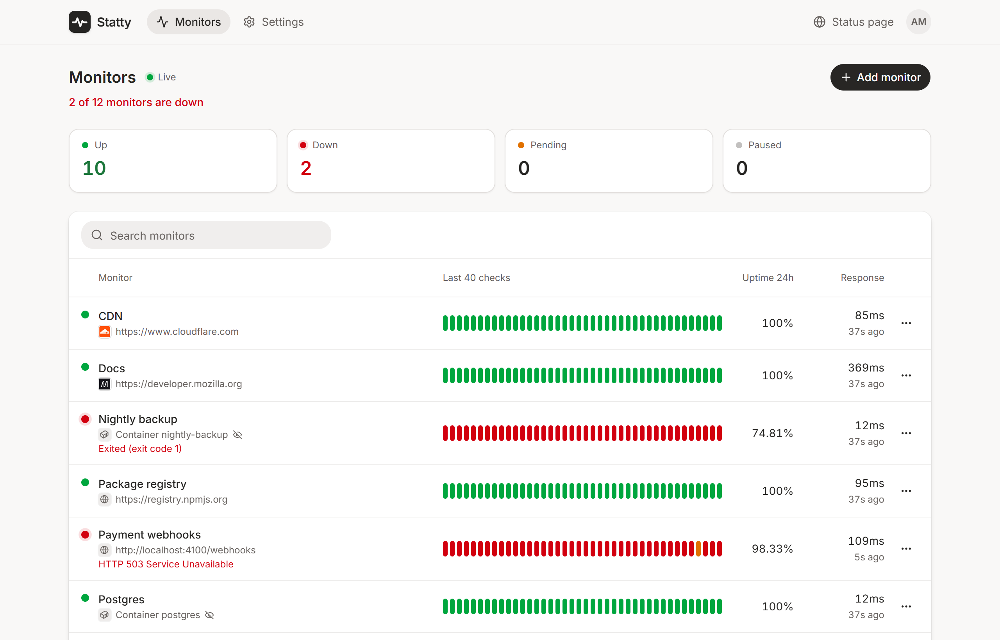
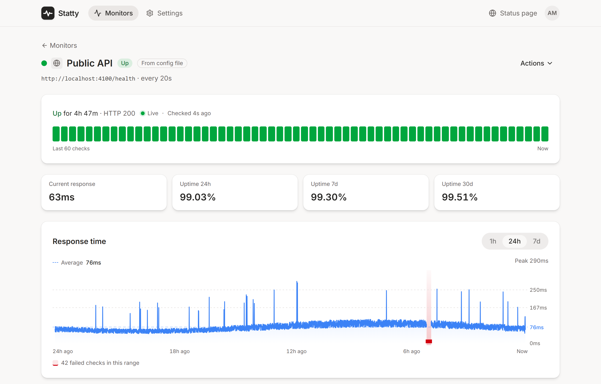
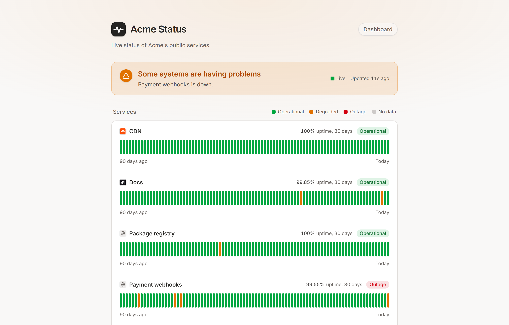
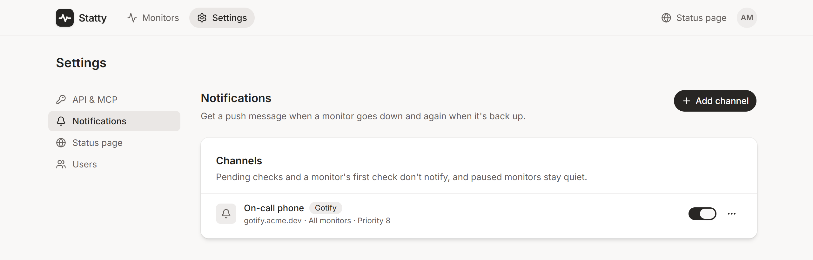
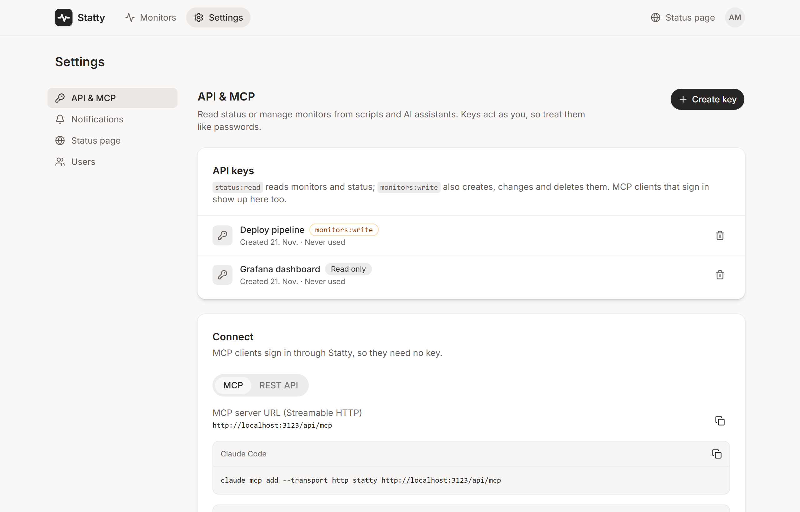
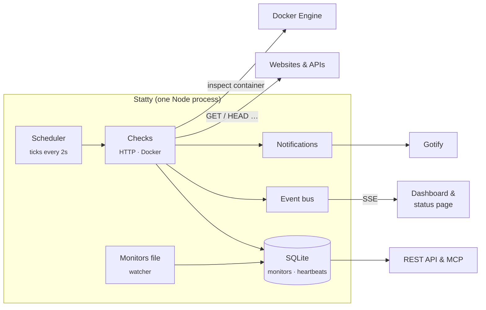

<div align="center">

# Statty

**A small, self-hosted status monitor for your websites and Docker containers.**

Health checks, a live dashboard, a public status page, push notifications, a REST API and an
MCP server for AI assistants. It runs as one container and keeps its data in one SQLite file.

[](https://github.com/Kellojo/statty/actions/workflows/docker-image.yml)
[](https://github.com/Kellojo/statty/pkgs/container/statty)


[Quick start](#quick-start) · [Tour](#a-tour) · [How it works](#how-it-works) ·
[Monitors file](#monitors-file) · [Configuration](#configuration) · [API](#rest-api) ·
[MCP](#mcp-server)

<br>

<picture>
  <source media="(prefers-color-scheme: dark)" srcset="docs/screenshots/dashboard-dark.png">
  
</picture>

</div>

## What is Statty?

Statty watches the things you run and tells you when one stops working. It's in the spirit of
Uptime Kuma, but deliberately smaller: a flat list of monitors, each one either

- a **URL check**: Statty requests a URL and checks the status code, and optionally that the
  body contains a keyword, or
- a **Docker check**: Statty asks the Docker Engine whether a container is running, and
  healthy if it has a health check.

Around that it gives you what you need to run it for real:

|                        |                                                                                                    |
| ---------------------- | -------------------------------------------------------------------------------------------------- |
| 📊 **Live dashboard**  | Status, 24h/7d/30d uptime, response-time charts and status history, updated live over SSE.         |
| 🌐 **Status page**     | A public page at `/status` with 90 days of daily uptime. Names and status only, never URLs.        |
| 🔔 **Notifications**   | Push to [Gotify](https://gotify.net) when a monitor goes down and when it recovers.                |
| 📄 **Config as code**  | Declare monitors in a YAML file. Statty applies it on startup and whenever it changes.             |
| 🔑 **REST API**        | Read status and manage monitors with scoped API keys.                                              |
| 🤖 **MCP server**      | Let Claude and other MCP clients read and manage monitors. They sign in with OAuth, no key needed. |
| 👥 **Accounts**        | Email + password, OIDC single sign-on, or both. The first account becomes admin.                   |
| 🪶 **Small footprint** | One Node process, one SQLite file, no Redis, no external database.                                 |

## Quick start

### Docker (recommended)

Prebuilt multi-arch images (amd64, arm64) are published to GHCR:

```sh
docker run -d --name statty -p 3000:3000 \
  -v statty-data:/data \
  -v /var/run/docker.sock:/var/run/docker.sock:ro \
  -e ORIGIN=https://status.example.com \
  ghcr.io/kellojo/statty:latest
```

Or with Docker Compose:

```yaml
services:
  statty:
    image: ghcr.io/kellojo/statty:latest
    ports:
      - '3000:3000'
    environment:
      ORIGIN: https://status.example.com
      APP_SECRET: change-me-to-a-long-random-string
    volumes:
      - statty-data:/data
      # Only needed for Docker monitors. Read-only is enough: Statty only inspects containers.
      - /var/run/docker.sock:/var/run/docker.sock:ro
    restart: unless-stopped

volumes:
  statty-data:
```

Then open `http://localhost:3000`, **create an account** (the first one becomes admin) and add
your first monitor.

> [!TIP]
> Not monitoring containers? Leave out the Docker socket and run the container as
> `--user node` with a `/data` volume that user owns.

### From source

```sh
pnpm install
cp .env.example .env   # set ORIGIN, APP_SECRET, OIDC_* as needed
pnpm dev               # development server with hot reload
# or
pnpm build && node build
```

Statty needs Node 22 or newer. The repository's `docker-compose.yml` builds the image from
source instead of pulling it.

## A tour

### Dashboard

The home page lists every monitor with its status, its last 40 checks, its 24h uptime and its
latest response time. Counters at the top add up what's up, down, pending and paused. Search
filters the list as you type. Everything updates in place as checks come in: numbers roll to
their new values, heartbeat bars grow in, and rows flash when their status changes.

HTTP monitors show their site's favicon, Docker monitors a container icon, and monitors that
are hidden from the status page carry a crossed-out eye.

### Monitor details

<picture>
  <source media="(prefers-color-scheme: dark)" srcset="docs/screenshots/monitor-dark.png">
  
</picture>

Click a monitor to see how long it has been in its current state, its last 60 checks, uptime
over 24 hours, 7 days and 30 days, and a response-time chart (1h, 24h or 7d) that marks failed
checks in red. Below it is a list of status changes. From **Actions** you can check it now,
pause or resume it, edit it or delete it.

### Adding a monitor

<picture>
  <source media="(prefers-color-scheme: dark)" srcset="docs/screenshots/add-monitor-dark.png">
  
</picture>

Pick **URL check** or **Docker**, give it a name and a target, choose how often to check, and
whether it appears on the public status page. The method sits next to the URL, and the rest is
under **Advanced**:

| Setting         | URL check | Docker | Meaning                                                                       |
| --------------- | :-------: | :----: | ----------------------------------------------------------------------------- |
| Method          |     ✓     |        | `GET`, `HEAD`, `POST`, `PUT`, `PATCH`, `DELETE` or `OPTIONS`                  |
| Accepted status |     ✓     |        | Status codes that count as up, e.g. `200-299,301`                             |
| Keyword         |     ✓     |        | Text the response body must contain                                           |
| Ignore TLS      |     ✓     |        | Accept invalid or self-signed certificates                                    |
| Docker host     |           |   ✓    | Another Docker Engine for this monitor (defaults to `DOCKER_HOST`)            |
| Timeout         |     ✓     |   ✓    | How long a check may take (at most the interval)                              |
| Retries         |     ✓     |   ✓    | Failures in a row to tolerate before the monitor is down (pending until then) |
| Description     |     ✓     |   ✓    | Shown with the monitor                                                        |

You can also create monitors from a [monitors file](#monitors-file), the [REST API](#rest-api)
or an [MCP client](#mcp-server).

### Public status page

<picture>
  <source media="(prefers-color-scheme: dark)" srcset="docs/screenshots/status-dark.png">
  
</picture>

`/status` is public: no sign-in needed. A banner sums up the overall state, and each service
shows 90 daily bars: green at 99% uptime or more, amber from 95%, red below that. Hover or tap a
day to see its uptime and failed checks. It updates live, too.

The page shows **names and status only**: never URLs, container names or error messages. You
choose per monitor whether it appears, and admins set the title and description under
Settings → Status page (or in the [monitors file](#monitors-file)).

### Notifications

<picture>
  <source media="(prefers-color-scheme: dark)" srcset="docs/screenshots/notifications-dark.png">
  
</picture>

Under Settings → Notifications, admins add [Gotify](https://gotify.net) channels: a server URL,
an app token and a priority (0–10, default 8). A channel covers all monitors, including ones
added later, or a set you choose. **Send test** checks it right away.

- **When Statty sends:** when a monitor turns down (from up, pending or not yet checked), and
  when it recovers from down. The recovery message says how long it was down. Pending checks,
  a monitor's first up check and paused monitors never send anything.
- **What it sends:** a markdown message that links to the monitor's page (using `ORIGIN`).
- **Delivery:** in the background, with a 10s timeout, so a slow notification server never
  delays checks. Failures are logged.
- **Token storage:** the token is encrypted at rest (AES-256-GCM, with a key derived from
  `APP_SECRET`) and is never sent back to the browser.

Channels are drivers behind a small interface, so other types (ntfy, webhooks) can be added
later.

### API keys & MCP

<picture>
  <source media="(prefers-color-scheme: dark)" srcset="docs/screenshots/api-dark.png">
  
</picture>

Settings → API & MCP is where you create API keys for scripts, and where you find the MCP
server URL with ready-to-copy setup commands. MCP clients you approve show up here as keys
too, so you can revoke them.

## How it works



### Checks and statuses

A **scheduler** in the server process ticks every 2 seconds. Each tick it picks the enabled
monitors whose interval has passed and checks them, up to 25 at once, with at most one check
per monitor in flight.

- **URL checks** request the URL with the monitor's method, following redirects. The monitor is
  up when the status code is in the accepted list and, if set, the body contains the keyword.
  Anything else (an unexpected status, a missing keyword, a timeout, a DNS or TLS error) is a
  failure, and its message says why.
- **Docker checks** call the Docker Engine API (`GET /containers/<name>/json`). A running
  container is up, or up only while healthy if it has a health check. A container whose health
  check is still `starting` is pending. Exited, restarting, paused and unhealthy containers are
  down. Statty only reads, so a read-only socket mount is enough. `DOCKER_HOST` can also point
  at a remote engine over TCP, and each monitor can name its own host.

Every check is stored as a **heartbeat** (status, response time, message, time), and the
monitor's current state is updated in the same transaction. A monitor is in one of five
states:

| Status      | Meaning                                                               |
| ----------- | --------------------------------------------------------------------- |
| **Up**      | The last check passed                                                 |
| **Pending** | Failing, but with retries left; or a container that is still starting |
| **Down**    | Failed `retries + 1` times in a row                                   |
| **Paused**  | Disabled; it isn't checked and doesn't notify                         |
| **Unknown** | Not checked yet                                                       |

**Uptime** is up checks divided by up and down checks over the period. Pending checks count
for neither, so a single blip that recovers within its retries doesn't hurt your numbers.
Heartbeats older than `HEARTBEAT_RETENTION_DAYS` (default 90) are pruned every hour.

### Live updates

After each check the server publishes an event. Signed-in pages listen on `/api/events` and the
status page on `/api/public/events`, both as server-sent events, so nothing polls. The public
stream carries the same redacted data as the status page. If the stream can't connect (for
example behind a proxy that buffers responses), pages fall back to reloading every 15–30
seconds.

### Site icons

For HTTP monitors Statty looks for the site's icon in the background: the home page's `icon` /
`apple-touch-icon` links (preferring SVG or a square PNG of 32px or more), else
`/favicon.ico`. It must be a real image under 256 KB. Icons are cached per origin, refreshed
weekly, and a failed search is retried after a day.

### Storage and security

- **One SQLite file** at `DATABASE_PATH` holds everything: users, monitors, heartbeats,
  settings, keys and cached icons. Back it up by copying the `/data` volume. Numbered SQL
  migrations in `migrations/` are applied on startup.
- **`APP_SECRET`** signs sessions and encrypts stored secrets. If you don't set it, Statty
  generates one into `<database dir>/.secret` (mode 0600). Set it explicitly in production.
- **API keys** look like `sty_<id>_<secret>`. Only an argon2 hash is stored; the key itself is
  shown once.
- The container has a built-in health check against `/api/health`.

## Monitors file

Instead of clicking monitors together, you can declare them in a YAML file and point
`MONITORS_FILE` at it. Statty applies it on startup and again whenever the file changes (it
re-reads it every `MONITORS_FILE_POLL_SECONDS`). No sync job or API key is needed. The format
is the same as [statty-sync-action](https://github.com/Kellojo/statty-sync-action), so one file
works with both.

```yaml
# statty.yaml
prune: true # delete monitors that are removed from this file (default)
statusPage: # optional
  title: Acme Status
  description: Live status of our services.
monitors:
  - name: Website
    type: http
    url: https://example.com
    intervalSeconds: 60
    retries: 2
  - name: postgres
    type: docker
    container: postgres
    public: false # not on the public status page
  - name: API
    type: http
    url: https://api.example.com/health
    keyword: '"status":"ok"'
    description: ${API_REGION} region # from the environment
```

Each entry takes the [monitor fields](#monitor-fields): `name` and `type` are required, plus
`url` for `http` monitors or `container` for `docker` monitors. See
[`statty.example.yaml`](statty.example.yaml) for a starting point.

- **Matching:** monitors are matched by name, ignoring case, so names must be unique.
- **Only the fields you set are managed.** A field you leave out gets Statty's default on
  create, and is never changed afterwards. If someone edits a field the file sets in the
  UI, it is set back the next time the file is applied.
- **Adopting:** a monitor made in the UI with the same name as an entry is taken over by
  the file.
- **Deleting:** with `prune: true`, a monitor that the file declared is deleted once you
  remove it from the file, along with its history. Monitors made in the UI or API are
  never deleted. With `prune: false`, removed monitors just go back to being managed in
  the UI.
- **Renaming** an entry creates a new monitor; with `prune` the old one is deleted.
- **Errors:** a file with any error (unknown fields, a missing `url`, invalid YAML) is not
  applied at all, so a typo can't delete monitors. Problems are logged.
- **Environment variables:** `${NAME}` is replaced with the environment variable `NAME`,
  and the file is refused when it isn't set. `$${NAME}` stays a literal `${NAME}`.
- Monitors from the file are labelled "From config file" in the app.

> [!IMPORTANT]
> With Docker, mount the file's **directory**, not the file itself. A single-file bind mount
> keeps showing the old file after an editor or deploy script replaces it.

```yaml
services:
  statty:
    image: ghcr.io/kellojo/statty:latest
    environment:
      MONITORS_FILE: /config/statty.yaml
    volumes:
      - ./data:/data
      - ./config:/config:ro # contains statty.yaml
      - /var/run/docker.sock:/var/run/docker.sock:ro
```

## Configuration

All settings are environment variables. See [`.env.example`](.env.example).

| Variable                                              | Default                                                                   | Notes                                                                              |
| ----------------------------------------------------- | ------------------------------------------------------------------------- | ---------------------------------------------------------------------------------- |
| `ORIGIN`                                              | request origin                                                            | Public URL; OAuth and notification links use it (else `localhost:$PORT`)           |
| `APP_SECRET`                                          | generated into `<db dir>/.secret`                                         | Signs sessions and encrypts stored secrets (e.g. Gotify tokens)                    |
| `PORT`                                                | `3000`                                                                    |                                                                                    |
| `DATABASE_PATH`                                       | `./data/statty.db` (`/data/statty.db` in Docker)                          |                                                                                    |
| `ENABLE_SIGNUP` / `ENABLE_PASSWORD_LOGIN`             | `true`                                                                    |                                                                                    |
| `OIDC_ISSUER`, `OIDC_CLIENT_ID`, `OIDC_CLIENT_SECRET` | –                                                                         | Callback URL: `<ORIGIN>/api/auth/oauth2/callback/oidc`                             |
| `OIDC_SCOPES`                                         | `openid profile email`                                                    |                                                                                    |
| `OIDC_ONLY`                                           | `false`                                                                   | Turns off password login and sign-up                                               |
| `AUTO_PROMOTE_FIRST_USER`                             | `true`                                                                    | The first account becomes admin                                                    |
| `DOCKER_HOST`                                         | `unix:///var/run/docker.sock` (Windows: `npipe:////./pipe/docker_engine`) | Also `tcp://host:2375`, `https://host:2376`. A monitor can set its own host.       |
| `HEARTBEAT_RETENTION_DAYS`                            | `90`                                                                      | Older checks are pruned hourly                                                     |
| `MONITORS_FILE`                                       | –                                                                         | YAML file declaring monitors, applied on startup ([Monitors file](#monitors-file)) |
| `MONITORS_FILE_POLL_SECONDS`                          | `30`                                                                      | How often to re-read `MONITORS_FILE` for changes; `0` reads it on startup only     |

### Sign-in

Statty supports email + password, OIDC (Pocket ID, Authentik, Keycloak, …), or both. The first
account becomes admin, and admins manage users under Settings → Users. To use only single
sign-on, set the three `OIDC_*` variables and `OIDC_ONLY=true`. To stop new sign-ups after you
have created your account, set `ENABLE_SIGNUP=false`.

### Reverse proxy

Set `ORIGIN` to the public URL. If your proxy buffers responses, turn that off for
`/api/events` and `/api/public/events` so live updates stream through (with Nginx:
`proxy_buffering off;`). Statty still works without it, falling back to periodic reloads.

## REST API

The API lives at `/api/v1`. Create a key under Settings → API & MCP and send it as a bearer
token:

```sh
curl -H "Authorization: Bearer sty_…" https://status.example.com/api/v1/status
```

Keys have one of two scopes:

- `status:read` reads monitors and status.
- `monitors:write` also creates, changes, pauses, deletes and checks them.

| Method | Path                                             | Scope            |
| ------ | ------------------------------------------------ | ---------------- |
| GET    | `/api/v1/status`                                 | `status:read`    |
| GET    | `/api/v1/monitors?recent=30`                     | `status:read`    |
| GET    | `/api/v1/monitors/:idOrName`                     | `status:read`    |
| GET    | `/api/v1/monitors/:idOrName/heartbeats?hours=24` | `status:read`    |
| POST   | `/api/v1/monitors`                               | `monitors:write` |
| PATCH  | `/api/v1/monitors/:idOrName`                     | `monitors:write` |
| DELETE | `/api/v1/monitors/:idOrName`                     | `monitors:write` |
| POST   | `/api/v1/monitors/:idOrName/check`               | `monitors:write` |
| GET    | `/api/public/status`                             | none (CORS open) |
| GET    | `/api/monitors/:id/favicon`                      | see below        |

Create a monitor:

```sh
curl -X POST https://status.example.com/api/v1/monitors \
  -H "Authorization: Bearer sty_…" -H "Content-Type: application/json" \
  -d '{ "name": "Website", "type": "http", "url": "https://example.com", "intervalSeconds": 60 }'
```

Errors come back as `{ "message": "field: problem" }`.

### Monitor fields

`name` (unique, ignoring case), `type` (`http` | `docker`), `url`, `method`,
`acceptedStatuses`, `keyword`, `ignoreTls`, `container`, `dockerHost`, `intervalSeconds`
(10–86400), `timeoutSeconds` (≤ interval), `retries`, `enabled`, `public`, `description`,
`sortOrder`. The schema is in `src/lib/server/monitor/input.ts`.

Responses also carry `faviconUrl`, which is null for Docker monitors or when no icon was found.
It is on `/api/public/status` too. `faviconUrl` points at `/api/monitors/:id/favicon?v=<hash>`,
which serves the cached icon. Public monitors' icons are served without sign-in; other
monitors need a session or `status:read`.

### Notification channels

Notification channels are managed by signed-in admins, not with API keys. The routes are
`GET`/`POST /api/notifications`, `GET`/`PATCH`/`DELETE /api/notifications/:id` and
`POST /api/notifications/:id/test`. A channel body is
`{ name, type: "gotify", enabled, allMonitors, monitorIds, config: { url, token, priority } }`.
On `PATCH`, a blank `config.token` keeps the stored one.

## MCP server

Statty is an [MCP](https://modelcontextprotocol.io) server at `/api/mcp` (Streamable HTTP,
stateless), so AI assistants can answer "is anything down?" or set up monitors for you.

```sh
claude mcp add --transport http statty https://status.example.com/api/mcp
```

- **Sign-in:** MCP clients use OAuth 2.1 with dynamic client registration and PKCE. The first
  time a client connects, your browser opens Statty's sign-in (password or OIDC), and you
  choose whether the client may change monitors. Each approval appears under
  Settings → API & MCP as a key you can revoke.
- **Tools:** `list_monitors` and `get_monitor`. With write access the client also gets
  `create_monitor`, `update_monitor`, `delete_monitor` and `check_monitor`.

## Image tags and releases

| Tag                         | Published when                                                       |
| --------------------------- | -------------------------------------------------------------------- |
| `:latest`, `:0.1.0`, `:0.1` | a version tag is pushed (`git tag v0.1.0 && git push origin v0.1.0`) |
| `:edge`                     | every push to `main`                                                 |
| `:sha-<commit>`             | every build                                                          |

The workflow is `.github/workflows/docker-image.yml`. On a tag it also sets `package.json`'s
version, so the version shown in the app matches the image.

## Development

Built with SvelteKit 2, Svelte 5, Tailwind 4, shadcn-svelte, better-sqlite3 and better-auth.

```sh
pnpm dev     # dev server
pnpm check   # typecheck
pnpm lint    # Prettier and ESLint
pnpm test    # unit tests
```

- Migrations are numbered SQL files in `migrations/` and are applied at startup. To change
  the schema, add the next file; don't edit an applied one.
- Server code lives in `src/lib/server/`:
  - `monitor/`: checks, scheduler and the service layer
  - `monitor-file/`: the monitors file (parsing, applying, watching)
  - `favicon/`: finding, validating and caching site icons
  - `notifications/`: notification channels. Each type is a driver; Gotify is in `gotify.ts`
  - `mcp/`: the MCP server
  - `oauth-server/`: OAuth for MCP
  - `db/repo/`: storage
- Screenshots in `docs/screenshots/` come from a local instance with demo data, in light and
  dark mode. GitHub shows the one that matches the reader's theme.
